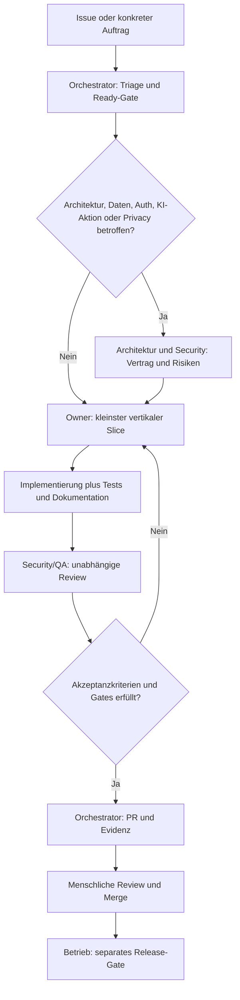

# Agentenorganisation & Orchestrierung

## 1. Zweck und Grenzen

Dieses Betriebsmodell koordiniert **Coding-/Dokumentationsagenten im Entwicklungsprozess**. Es ist getrennt vom produktiven `llm-hub`, der KI-Queue und der Fach-Workflow-Engine. Agentenprofile allein starten keine Hintergrunddienste und stellen weder Autonomie noch Berechtigung dar. Ein Mensch besitzt Produktpriorität, Sicherheitsfreigaben, GitHub-Merge und Deploymententscheidung.

Quellen der Muster (nur als Prozessreferenzen, kein Kopieren von fachfremder Technik):

- `derdigitalaffine/kostuemwettbewerb`: AGENTS.md, kritische Reihenfolge, Datenschutz-Invarianten.
- `derdigitalaffine/wf-app`: vertikale Slices, Ready/Done, modularer Scope, CI-/Mobile-Smokes.
- `derdigitalaffine/takt-platform`: aufgabenorientierte Zusammenarbeit, PR-UX-Gate, Organisations-/Rechte-Trennung.

## 2. Zuständigkeiten (RACI)

R = arbeitet, A = finale Verantwortlichkeit, C = prüft/berät, I = informiert.

| Tätigkeit | Orchestrator | Architektur/Daten | Backend/AI | Frontend/UX | Security/QA | Docs/Ops | Mensch |
| --- | --- | --- | --- | --- | --- | --- | --- |
| Priorisieren/Issue schneiden | R | C | C | C | C | I | A |
| API/Datenvertrag festlegen | C | R | R | C | C | I | A bei Breaking Change |
| Backend-/Workflow-Implementierung | I | C | R | C | C | I | A für Merge |
| UI / Kernflow | I | C | C | R | C | C | A für Merge |
| Negativtests / Security-Befund | I | C | C | C | R | I | A bei Risikoakzeptanz |
| Betrieb / Release-Doku | I | C | C | C | C | R | A für Deployment |

Kein Agent gibt seine eigenen P0-Sicherheitsänderungen frei. Jeder Task hat **genau einen führenden Owner**; Reviewer dürfen parallel arbeiten, solange sie dessen Arbeitsdateien nicht editieren.

## 3. Arbeitsgraph



Der Graph ist eine Arbeitsanweisung, **kein automatisch gestarteter Workflow**. Für echten automatischen Dispatch wäre später eine kontrollierte Integration mit Identitäts-, Budget-, Berechtigungs- und Auditmodell erforderlich.

## 4. Klassen und Eskalation

| Klasse | Beispiele | Zusätzliche Bedingung |
| --- | --- | --- |
| `docs-only` | erklärende Doku, Links, ADR | Fakten mit Code/Quellen prüfen, Linkcheck |
| `ui` | Frontend-Komponente, Texte | Mobile, Keyboard, A11y, Permission-Varianten |
| `api` | neuer/angepasster Endpoint | Auth/Tenant/OpenAPI/Fehlervertrag, Negativtests |
| `data` | Schema, Import, Restore | Migration, bestehende Daten, Backup/Rollback |
| `ai` | Prompts, Routing, KI-Queue | Providerdaten, Grenzen, Human approval, Prompt-Injection |
| `critical` | Auth, RBAC, PII, Tenant, Löschung, Sicherheitskonfig | Security-Review **vorher und nachher**; keine Self-Approval |

Eskalieren statt still lösen bei: unklarer Rechts-/Datenschutzgrundlage, personenbezogenen Echtdaten, unerwartetem externem Versand, cross-tenant-Zugriff, irreversibler Migration, Bruch bestehender API, unbekanntem Produktionszustand oder verweigerter Tool-Berechtigung.

## 5. Parallelarbeit ohne Konflikte

**Parallel möglich:** Backend-Domain-Testplan, UX-Review und Doku-Entwurf auf getrennten Dateien, solange ein gemeinsamer API-/Domainvertrag beschlossen ist. **Sequenziell nötig:** Schema → Backend/Autorisierung → Frontend-Integration → Cross-Component-Test; Security-Review vor Merge. Für P0 niemals zwei Agenten gleichzeitig an derselben Migration, zentralen Routes- oder Auth-Datei ohne explizite Koordination.

Pfadverantwortung:

- `backend/src/db/`, `backend/src/database.ts`: Architektur/Daten + Backend; Security zwingend bei Scope/PII.
- `backend/src/routes/`, `backend/src/services/`: Backend/AI; API-Kontrakt mit Frontend abstimmen.
- `frontend/`: Frontend/UX (Bürger) und Backend als API-Partner.
- `admin/`: Frontend/UX (Sachbearbeitung) und Backend für RBAC.
- `ops/`: Frontend/UX (Mobil/Offline) und Backend für Sync/Idempotenz.
- `nginx/`, `xmpp/`, `docker-compose*.yml`, `.env.example`: Docs/Ops und Security/QA.
- `docs/`, `README.md`, `AGENTS.md`: Docs/Ops, Querschnittsreview nach Inhalt.

Ein Agent darf einen kleinen Code-/Doku-Slice selbst abschließen, aber nicht unabhängige Security-Freigabe simulieren.

## 6. Übergabevertrag und Nachvollziehbarkeit

### Triage-Karte

```yaml
id: ISSUE-ODER-AUFTRAG
priority: P0|P1|P2
owner_role: backend|frontend|architecture|security-qa|docs-ops
review_roles: [security-qa]
goal: "Beobachtbares Nutzer-/Betriebsziel"
non_goals: ["Explizite Abgrenzung"]
paths: ["backend/src/..."]
contracts: ["API / DB / Rollen / Ereignisse"]
risks: ["Tenant, PII, KI, Offline, Migration, Audit"]
acceptance: ["Gegeben-Wenn-Dann oder messbarer Check"]
status: ready|in_progress|blocked|in_review|verified
```

### Agent-Übergabe

Jeder Output nennt: Commit/Branch, betroffene Dateien, geänderten Kontrakt, offene Alternativen, ausgeführte Befehle samt Ergebnis, nicht ausgeführte Prüfungen, Begründung und Rückfallebene. Bei Blocker Eigentümer wechseln nur mit dokumentiertem Konflikt.

### Review-Gates

1. **G0 Ready:** Akzeptanz, Rollen/Org-Scope, betroffene Endpunkte, Datenmigration, Audit, Offline/Realtime geklärt.
2. **G1 Architecture:** Verträge, Breaking-Change-Risiko, Lifecycle und Versionierung festgelegt.
3. **G2 Implementation:** kleinster funktionierender Slice, Tests, Fehlerfälle und Doku im PR.
4. **G3 Assurance:** objektive Testevidenz, Security/UX-Review, fehlende Tests sichtbar, kein Datenleck.
5. **G4 Human:** PR-Approval, Branch-Schutz und CI; kein autonomer Merge/Release.
6. **G5 Operations:** Preflight, Backup, Release-Tag, Smoke, Rückrollentscheidung.

## 7. Beispiel: KI-gestützte Ticketzuordnung

- Orchestrator zerlegt in Vertrags- und Implementierungsarbeit, benennt menschlichen Freigabepunkt.
- Architektur definiert Tenant-/Org-Scope, Eingabe-/Ausgabeformat, Confidences, Fehl- und Fallbackfälle.
- Backend implementiert Queue-/Retrylogik mit idempotenter Zustandsänderung; KI liefert **Vorschlag**, keine unkontrollierte Zuweisung.
- Frontend zeigt Quelle, Unsicherheit und Bestätigung; Abbruch lässt das Ticket unverändert.
- Security/QA testet fremden Tenant, schadhafte Prompt-Texte, Provider-Ausfall, doppelte Queue-Events und fehlende Rechte.
- Docs/Ops dokumentiert Einstellungen, Limits, Logs ohne PII, Monitoring und manuellen Fallback.

## 8. Wartung des Agentensystems

Änderung an Rollen, Handoffs oder Gates wird als Doku-/Governance-PR behandelt. Die Profile in `.github/agents/*.agent.md` müssen mit `AGENTS.md` übereinstimmen. Versionierte ADRs erklären strukturelle Änderungen. Instrumentierung für autonomes Multi-Agent-Running ist eine **separate spätere Engineering-Aufgabe**, keine implizite Eigenschaft dieser Dateien.

## Maschinenlesbarer Gate-Vertrag

Die deklarative Matrix in [`agents/orchestration.json`](../agents/orchestration.json) beschreibt die Rollen- und Freigabeabhängigkeiten. `node scripts/check-agent-orchestration.mjs` kontrolliert Profilzuordnungen, unabhängige Reviews, menschliche Freigabepflichten und Zyklusfreiheit. Das ist **eine verifizierbare Entwicklungsprozess-Spezifikation**, kein autonomer Agent-Runner und keine operative KI-Agentenplattform.
