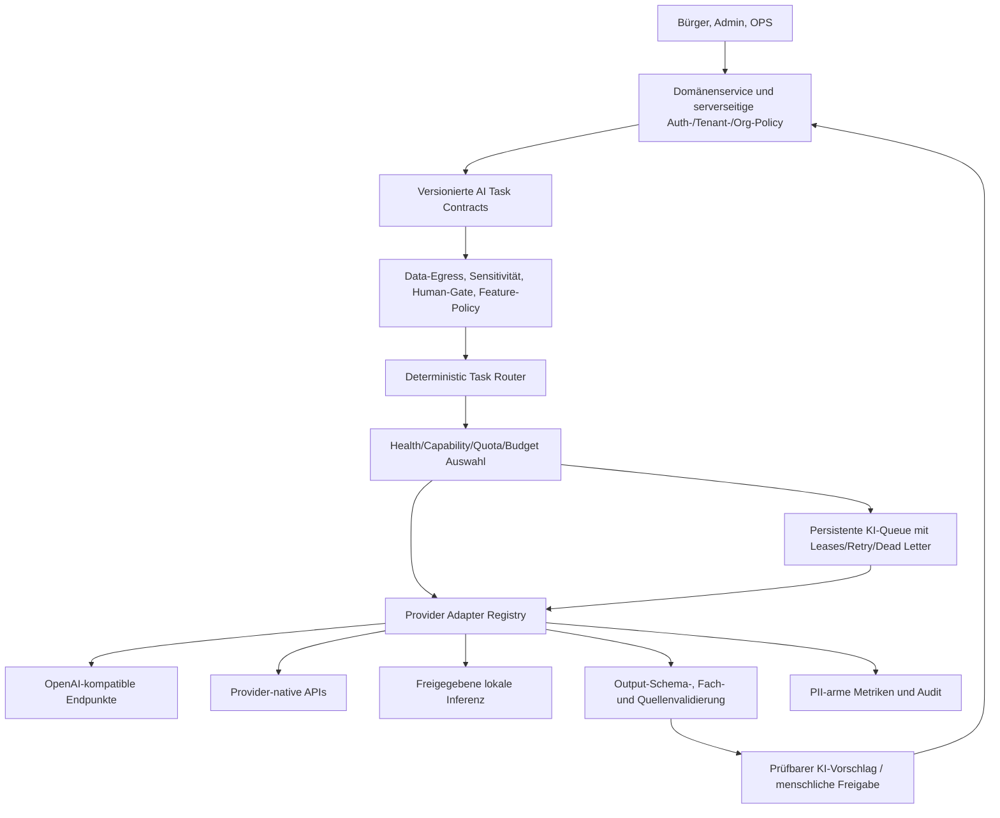

# KI-Backend-Strategie · Provider-Fabric und verlässliche Fachassistenz

**Stand:** 06.11.2026 · **Status:** Architektur- und Umsetzungszielbild, nicht als implementiert zu verstehen. **Quellbasis:** Fork `derdigitalaffine/behebes-ai` mit bestehenden `backend/src/services/llm-hub.ts`, `ai.ts`, `image-ai.ts`, `ai-client.ts`, `openai.ts`, `backend/src/config.ts` sowie Admin `AIProvider.tsx`, `AIQueue.tsx` und `AIPromptTest.tsx`.

## Produktmaßstab

Die KI muss der **zuverlässigen kommunalen Fallbearbeitung** dienen, nicht dem Vorzeigen möglichst vieler Modelle. Sachbearbeitung und OPS benötigen korrekte, erklärbare und redigierbare Vorschläge; Bürger brauchen verständliche Kommunikation, Datenschutz und bei Ausfall eine funktionierende manuelle Alternative. **KI macht Vorschläge; Menschen verantworten Entscheidungen und außenwirksame Aktionen.** Kein „autonomer Sachbearbeiter“.

Priorisierte Taskgruppen:

1. **Klassifikation & Zuständigkeit:** strukturierte Kategorien, Einheiten, Quelle/Begründung, kein automatisches Umhängen ohne Autorisierung.
2. **Übersetzung & Bürgerkommunikation:** verständliche, mehrsprachige Texte mit Signatur/Freigabe vor Versand.
3. **Workflow-Assistenz:** geprüfte Kandidaten, Schema-/Statusvalidierung, keine ungeprüften externen Calls oder Eingabe als privilegierter Code.
4. **Bild-/Dokumenterkennung:** nur bei zulässiger Bildübermittlung; redigierter Kontext, validiertes Ergebnis und manuelle Kontrolle.
5. **Interne Assistenz, Lagebild, Hilfesystem:** Zugriff streng nach Tenant/Org/Capability und freigegebenen Wissensquellen.

## Ist-Inventar und derzeitige Risiken (aus Code abgeleitet, nicht produktiv verifiziert)

- `llm-hub.ts` verwaltet `openai_compatible`-Connections mit `api_key`/`oauth`, Task-Routing, Modell-/Capability-Cache (6 Stunden) und Migration historischer Einstellungen.
- Das Modell `vision`/`tts`/`imageGeneration` wird teilweise heuristisch über Modellnamen bzw. veröffentlichte Metadaten erschlossen. **Eine Heuristik ist kein Fähigkeitsnachweis**.
- `fetchOpenAiCompatibleModels` versucht mehrere `/models`-Pfadvarianten; Provider unterscheiden sich bei API-Scope und unterstützten Features.
- `ai.ts` besitzt eine persistierte KI-Queue mit `pending/retry/processing/done/failed/cancelled` und Worker-Timer; `image-ai.ts` erstellt separat OpenAI-SDK-Clients.
- `backend/src/config.ts` enthält noch eine Legacy-Provider-Konfiguration, die `askcodi` als Default/temporäre Festlegung verwendet; `ai-client.ts` und `openai.ts` sind parallel vorhandene ältere Pfade. Vor Entfernen echte Referenzen und Migration nachweisen.
- Die Admin-UI ermöglicht Provider- und Task-Konfiguration sowie KI-Tests/Queueverwaltung, benötigt aber einen vollständigen Betriebs-/Datenschutz-/Kosten-/Freigabekontext.
- Kein belastbarer Beleg für produktive SLA, korrekte Provider-Failover-Semantik, verbindliche Datenausleitungs-Policies, Golden-Evaluationsabdeckung oder sichere Ende-zu-Ende-Queue-Idempotenz.

## Zielarchitektur als logischer Provider-Fabric



Das Diagramm beschreibt **SOLL**, nicht eine schon implementierte Ablaufkette. Provideradapter sind Backendmodule, nicht beliebiger aus Datenbankwerten ausgeführter Code.

## Kernverträge

### 1. Task Envelope

Jede KI-Anfrage hat: `taskKey` und `taskVersion`, `tenantId`/`orgScope`/`actor`, Zweck, Sensitivitätsklasse, Locale, promptVersion, erlaubte Fähigkeiten/Providerklassen, Input-/Output-Schema, Timeout, Kosten-/Token-/Retrybudget, Correlation-/Idempotency-Key und menschlichen Freigabetyp. Den freien `purpose`-String nur noch als Legacy-Adapter interpretieren. **Niemals** unberechtigte Tenant-IDs direkt aus User-Payload übernehmen.

### 2. Provider Adapter

```ts
interface AiProviderAdapter {
  id: string;
  capabilities(): Promise<ModelCapabilityMatrix>;
  probe(request: ProviderProbe): Promise<ProviderHealth>;
  generate(request: ValidatedInferenceRequest, signal: AbortSignal): Promise<ValidatedTransportResponse>;
  stream?(request: ValidatedInferenceRequest, signal: AbortSignal): AsyncIterable<ValidatedStreamChunk>;
}
```

Ein einheitliches Ergebnis beinhaltet normalisierte `responseId`, `modelVersion`, `finishReason`, `usage` mit Unsicherheitsflag, `providerLatencyMs`, `output`, `rawOutputRef` (streng kontrolliert, falls überhaupt zulässig) und klassifizierte Fehler. SDK-/Endpointdetails gehören hinter Adapter, fachliche Dienste instanziieren keine eigenen Providerclients.

**Capabilities sind versioniert und für konkrete Modell-/Deploymentkombinationen zu prüfen:** Chat, Structured Output/JSON Schema, Tool Calls, Reasoning, Vision, Streaming, Embeddings, Kontext-/Outputlimit, Usage, Bildtransport und Datenschutz-/Regionseigenschaften. Liste `/v1/models` beweist Fähigkeiten nicht. Unbekannt = nicht für kritischen Task auswählen.

### 3. Kompatibilität nicht behaupten, sondern messen

| Backend-Klasse | Einstieg | Spezifische Prüfung |
| --- | --- | --- |
| OpenAI-kompatible Cloud-API | Chat/Responses je freigegebenem Adapter | Supported Fields, Response-Shape, JSON/Tools, Auth/Rate-Limits und Usage getrennt |
| Azure OpenAI / herstellerspezifische APIs | eigene native Auth/Deployments/API-Version | Regionen, Deployment-/Modellidentifikatoren, API-Version/Usage-Format |
| Ollama (lokal/verwaltet) | freigegebene On-Prem OpenAI-kompatible Teil-API | Modell installiert, /models-/Vision-/Tool-/Streaming-Subset, Kontextgröße |
| vLLM | gesicherter Inferenzdienst mit definierter Endpoint-Policy | nicht jede Route durch API-Key gesichert; externe Abschottung und Model-Featuretests |
| Weitere Provider / Gateways | Adapter nach konkretem Vertrag | keine universelle OpenAI-Kompatibilität unterstellen, Terms/Data-Egress prüfen |

Offizielle Protokoll-/Kompatibilitätsreferenzen: https://platform.openai.com/docs/api-reference · https://docs.ollama.com/openai · https://docs.vllm.ai/en/latest/serving/openai_compatible_server.html. Version/Deployment im Architektur-ADR festhalten. Integration gilt erst nach Adapter-Contract-Suite als unterstützt.

### 4. Routing und Failover

Das Routing prüft in dieser Reihenfolge: **Berechtigung → Tenant/Org → Modulfreigabe → Datenklassifikation/Egress/Region → Task-Fähigkeiten → Provider-/Model-Health → Budget/Quota/Rate → explizite Routingpriorität → Generation**. Jeder Entscheid erzeugt eine redigierte, nachvollziehbare Decision-ID. Explizites Modell und Fallback sind nur gültig, wenn **alle** Policies greifen.

Bei Störung: fehlendes Pflichtfeature = `unsupported`; technische Fehler über Circuit Breaker/Timeout/Retrybudget; bei policy-verbotener Datenausleitung oder fehlender Rechtsgrundlage **fail closed**, nicht automatischer Wechsel auf öffentlichen Cloudanbieter. Bei 429 `Retry-After` beachten. Bei externen Side Effects keine unkontrollierte Wiederholung; KI-Queue und eigentliche Fachaktion getrennt bestätigen.

### 5. Secrets, Netzwerk und Datenschutz

Connection-UI speichert keine Tokens im Klartext zurück an Nutzer. Geheimnisse werden nach Berechtigung maskiert, per Referenz verwaltet, rotiert und bei Audit-/Log-/Error-/Provider-Test strikt redigiert. API-Keys und OAuth sind nicht herstellerübergreifend gleich; Tokenrefresh nur bei tatsächlich vereinbartem Providerflow.

Administrierbare Base URLs benötigen **ausdrücklich konfigurierte Egress-Policy**. HTTPS/TLS, Netzwerk-/IP-/DNS-Grenzen und Redirect-/Authheader-Verhalten vor Zugriff prüfen; lokale Dienste ausschließlich über freigegebenes Netz. Kein „beliebiger URL-Test“ unter Produktionsidentität. Datenklassifikation und Serverpolicy gelten ebenso bei Providerprobe, Modellauflistung und Embedding.

Bei Bürger-/Verwaltungsdaten: expliziter Zweck, minimale Felder, sinnvolle Pseudonymisierung, genehmigte Anbieter-/Region-/Speicherregeln, Löschung/Retention, Provider-Vertragsgrundlage. Keine automatischen außenwirksamen Entscheidungen allein aus generierten Texten.

### 6. Laufzeit, Kosten und Qualität

- **KI-Queue:** stabiler TaskEnvelope, Lease/Claim, Idempotency, RetryAt, Dead Letter, Cancel, Doppelverarbeitung, Crash-/Acknowledge-Test, manueller Fallback.
- **Qualität:** synthetische Golden-Fälle für Klassifikation, Zuständigkeit, Übersetzung, Workflow und Bildbefunde; Ausgabe-Schema und fachliche Validatoren; Evaluationsergebnisse bei Provider-/Prompt-/Modelupdate.
- **Monitoring:** Requests/Task/Modell/Provider, Latenz p50/p95/p99, TokenUsage mit Unsicherheitsflag, Retry-/Refusal-/Schema-Fehler, Queue-Lag, Kosten nach Tarifversion. Keine Bürgertexte, Geheimnisse, Rohprompts oder Anhänge in Logs.
- **Budget:** Soft/Hard per Tenant/Task/Provider, Kosten-/Quota-Rückmeldung im Admin, AI-Kill-Switch, kein stiller teurer Fallback.
- **UX:** Mantine-KI-Cockpit für Health, Connections, Capability, Test mit synthetischen Daten, Routing-Dry-Run, Kosten, Changes/Audit, verständliche Fehler und human approvals.

## Direkter Arbeitsvorrat auf GitHub

- [Epic #72: KI-Backend-Plattform](https://github.com/derdigitalaffine/behebes-ai/issues/72)
- [K01 #73: Ist-Aufnahme und Providerarchitektur](https://github.com/derdigitalaffine/behebes-ai/issues/73)
- [K02 #74: Typisierte Provideradapter](https://github.com/derdigitalaffine/behebes-ai/issues/74)
- [K03 #75: Sichere KI-Credentials und Tenant-Scope](https://github.com/derdigitalaffine/behebes-ai/issues/75)
- [K06 #78: Deterministisches Task-Routing](https://github.com/derdigitalaffine/behebes-ai/issues/78)
- [K13 #85: Qualitätsevaluation](https://github.com/derdigitalaffine/behebes-ai/issues/85)
- [K14 #86: Mantine-KI-Cockpit](https://github.com/derdigitalaffine/behebes-ai/issues/86)
- [K22 #94: Provider- und Chaos-Regressionen](https://github.com/derdigitalaffine/behebes-ai/issues/94)

## Implementierungsreihenfolge nach Milestones

| Milestone | KI-Lieferziel |
| --- | --- |
| M0 | K01: Ist-Inventar/ADR und Baseline mit realem Quellcode- und Migrationsbezug |
| M1 | K02–K05, K07, K08, K13, K16: Adapter, Credential-/Endpoint-/Data-Egress-Schutz, verifizierte Fähigkeiten und Evaluationsgrundlage |
| M2 | K06, K09, K12: deterministisches, policygesteuertes Routing, Outputvalidierung, KI-Queue |
| M3 | Mantine-Grundkomponenten als Voraussetzung für KI-Cockpit |
| M4 | Golden Path mit kontrollierter KI-Unterstützung und manuellem Fallback |
| M5 | K10, K14, K18–K21: Multimodal, Admin-KI-Cockpit, lokale/native Backends, Legacy-Migration und menschliche Freigaben |
| M6 | K11, K15, K22: Streaming, Budgets, KI-Observability und Provider-Chaos-/Contract-Gates |
| M7 | K17: optionale, tenant-sichere RAG-/Wissenskontexte nach Freigabe und Prüfung |

## Gemeinsame Qualitätsmatrix vor jedem Provider-Go-live

| Testfamilie | Minimalkriterien |
| --- | --- |
| Auth/Isolation | ungeprüfter Tenant/Org, Modul deaktiviert, Token widerrufen, Credentials verdeckt |
| Transport | DNS/HTTP/TLS/AuthError/Redirect/Timeout/429/500/ProviderOffline, Circuit Recovery, Cancellation |
| Kompatibilität | fehlende Model List, unbekannte Fähigkeiten, Chat-/JSON-/Vision-/Streaming-/Tool-Unterschiede |
| Fachqualität | Schema, erlaubte Kategorie/Org, Halluzination, Prompt Injection, unklare Quellen, verweigerte Antwort |
| Queue/Resilienz | Retry, Doppeljob, Workercrash, Replay, Kostenbudget, Human Gate |
| Betrieb | Upgrade Altinstallation, Local-only/Cloud Policy, Rollback, Logs ohne PII, Monitoring |

Ein Provider wird nur als „unterstützt“ dokumentiert, wenn konkrete Adapter- und Modellkonfigurationen diese Matrix bestehen. Ein neuer API-Key allein schaltet **keine** Freigaben frei.

[Master-Roadmap](ROADMAP.md) · [Milestones](MILESTONES.md) · [Modularchitektur](MODULE_PLATFORM.md) · [Security und Privacy](SECURITY_PRIVACY.md) · [K01–K22 in Issue-Katalog](../planning/roadmap-issues.json)

## K07-Implementierung: DNS-Pinning (PR #99)

Nach dem isolierten Sicherheitsgateway aus PR #98 verbindet der neue HTTPS-Transport nun ausschließlich auf eine zuvor geprüfte und für den Request gepinnte IP. Er prüft **sämtliche A-/AAAA-DNS-Antworten** und lehnt Spezial-/Privatadressen, gemischte Antworten und ungeprüfte Origins ab. TLS validiert weiterhin das Zertifikat für den ursprünglichen Provider-Hostnamen, nicht für die gepinnte IP. Die Secret-Referenz wird erst nach erfolgreicher DNS-/Endpoint-/Tenantprüfung geladen.

**Status:** technisch implementierter, aber **nicht im produktiven LLM-Hub eingeschalteter** Baustein. Infrastruktur-Egress-Firewall, Secret-Lifecycle, datenschutzrechtlich geprüfte Providerfreigaben, Integrations-/Netzwerkausfalltests und ein unabhängiger Security-Review bleiben Pflicht. [ADR-0008](ADR-0008-AI-PINNED-EGRESS.md) · [PR #99](https://github.com/derdigitalaffine/behebes-ai/pull/99).

## K03-Implementierung: geprüfte Secret-Bindings (PR #100)

Das isolierte Gateway hat einen konkreten serverseitigen Credential-Resolver erhalten, der **Tenant, Provider und Verbindung** bei jedem Secret-Read exakt vergleicht. Nur explizit genehmigte `AI_PROVIDER_*`-Keys können aus einem sicheren Reader bezogen werden; bei einem fremden Scope wird der Store nicht kontaktiert. Ein Environment-Reader ist als Deployment-Baseline verfügbar, darf aber nicht als vollständiger Managed-Secretmanager oder automatische Container-Rotation missverstanden werden.

**Weiter offen:** Secretmanager-Verschlüsselung/-Rotation/-Audit, sichere Übernahme bestehender `llmHub`-/OAuth-Credentials, Admin-/RBAC-Freigaben und vollständige Produktivintegration. [ADR-0009](ADR-0009-AI-CREDENTIAL-BINDINGS.md) · [K03 #75](https://github.com/derdigitalaffine/behebes-ai/issues/75).
