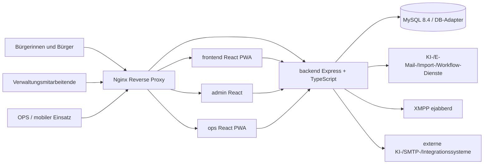

# Technische Architektur und Verantwortungsgrenzen

## Stand und Ziel

Ist-Aufnahme aus `main` @ `12ae45fa` (05.11.2026). Architektur dokumentiert überprüfbare Komponenten und überprüfungsbedürftige Verträge; sie ersetzt weder Bedrohungsmodell noch einen Laufzeittest.

## Systemkontext

Das Diagramm zeigt logische Verbindungen; konkrete Proxy-Routen siehe `nginx/conf.d/default.conf`, Compose in `docker-compose*.yml`. Externe Integrationen können optional sein. Keine öffentliche Erreichbarkeit einzelner Container voraussetzen.

## Verzeichnis → fachliche Aufgabe

| Pfad | Verantwortung | Besondere Checks |
| --- | --- | --- |
| `backend/src/index.ts` | Express-App, Middleware, Route-Mounts, Workerstart | Trust Proxy, CORS, Auth, Health, Lifecycle |
| `backend/src/routes/` | API und Berechtigungsgrenzen | Endpunkt-/Methodenvertrag, Tenant/Org, Fehlerfälle |
| `backend/src/services/` | Domäne, KI-/E-Mail-/Realtime-Integration | Idempotenz, Retry, Datenschutz, Audit |
| `backend/src/db-adapter.ts`, `database.ts` | Persistenz/Adapter und Legacy-Evolution | Transaktionen, Schema-Drift, Migrationen |
| `backend/src/db/migrations/` | registrierte versionierte Migrationen | Checksummen, bestehende Daten, Restore |
| `backend/src/openapi.ts` | beschriebener HTTP-Vertrag | Abgleich zur echten Route nötig |
| `frontend/src/` | Bürgermeldungen, Status, Auth, PWA | Datenschutz, Mobil, Fehler, Offline |
| `admin/src/` | Tickets, Arbeitslisten, Workflows, Einstellungen | Rechte, Scopes, gefährliche Aktionen |
| `ops/src/` | mobile Aufgaben, Tickets, Offline-Queue | Sync-Fehler, Idempotenz, Touch |
| `backend/knowledge/` | Kategorien/Workflow-Definitionen | Versionierung, Validierung und Ausführungsschutz |
| `xmpp/` | ejabberd-Konfiguration | Transport/Calls, Credentials, Abschottung |
| `nginx/` | Reverse Proxy | TLS-Terminierung extern, Header/CSP, Routing |

## Identität und Mandantenmodell

Der Server ist die einzige Autorität für Benutzer, Rollen, Tenant und Organisationszugehörigkeit. Ein UI-Role-Guard dient der Bedienführung, nicht der Durchsetzung. Neue Datenobjekte müssen ihren Tenant-/Org-Kontext explizit tragen oder als globale Referenz begründet sein. API-/Servicepfade dürfen keine frei gewählte `tenant_id` ungeprüft übernehmen. Tests müssen dieselbe Anfrage für erlaubte, unerlaubte und fehlende Kontexte abdecken. Audit-Einträge werden nicht mit Anwendungszustand verwechselt.

## Request- und Ereignisfluss

1. Proxy routet `/`, `/admin`, `/ops`, `/api` an die zugehörige Anwendung.
2. Frontend übermittelt Token/Sitzung und fachliche Eingaben; Backend validiert, authentifiziert und autorisiert.
3. Service- und Persistenzschicht verarbeitet mit nötigen DB-Transaktionen und Auditierung.
4. Länger laufende Vorgänge gehen in vorhandene Queue-/Workerpfade; Zustandsübergänge sind zu beobachten und sicher wiederholbar.
5. Admin/OPS beziehen Status über SSE und/oder XMPP; verlorene Events brauchen Re-Fetch/Resync.
6. Externe KI-/Mail-Provider erhalten nur definierte, minimierte Daten; Provider-Ausfall darf nicht zu unkontrollierter Aktion führen.

## KI-Architektur: Bestandskomponenten versus Entwicklungsagenten

Produkt-KI: `backend/src/services/llm-hub.ts` verwaltet Verbindungen, Modellliste, Default-/Task-Routing, optionale Chatbot-Kontextquellen. `backend/src/services/ai.ts` enthält eine persistente KI-Queue mit `pending`, `retry`, `processing`, `done`, `failed`, `cancelled` und Workerlogik. Diese Bestandskomponenten dürfen nicht mit `.github/agents/*.agent.md` verwechselt werden: **Letztere sind Rollenprompt-/Arbeitsdateien, keine zur Laufzeit geladenen Services.**

Erweiterungen an KI-Aufgaben benötigen: festes Task-Key-Schema, Datensparsamkeit, Input-Limits, vertrauenswürdige Systeminstruktion, Ausgabeschema/Validierung, Timeout-/Retry-/Kostenlimit, Audit, menschlichen Fallback und klare Entscheidung, welche Aktion KI überhaupt beeinflussen darf.

## Persistenz und Migrationen

Der Compose-Standard verwendet MySQL 8.4; der Code besitzt einen DB-Adapter und dokumentierte SQLite-Legacypfade. Das Migrationsregister befindet sich in `backend/src/db/migrations/index.ts`; ausgeführte Einträge werden mit Checksumme in `schema_migrations` nachvollzogen. Keine bestehende Migrationsdefinition ändern. Vor Änderungen: Snapshot/Backup, erwartete Datenmenge, Downtime-Risiko, Null-/Backfill-Plan, Restore-Probe.

## Risiken und technische Schulden (prüfpflichtig)

- Große zentrale Dateien (`routes/workflows.ts`, `routes/admin.ts`, `admin/src/pages/WorkflowSettings.tsx`) erschweren Ownership und Tests. **Keine Big-Bang-Neufassung:** modulare Extraktion nur mit Contract-/Regressionstests.
- Legacy-Schema-Bootstrap und Migrationen erfordern saubere Drift-/Upgrade-Tests.
- Mehrere Worker innerhalb des Backendprozesses benötigen überprüfte Konkurrenz-/Restart-/Retry-Semantik.
- Produktive Compose-Defaults und Secret-Verwaltung separat härten (siehe `SECURITY_PRIVACY.md`).
- Browser, App-/PWA-Versionen und Offline-State müssen nach Deployments kompatibel bleiben.

## Architekturentscheidungen

Neue Services, neue Queue, andere Datenbank, fachliche Umstrukturierung oder Breaking API brauchen ADR mit Problem, Optionen, Auswirkungen, Rollback und Tests (`DECISIONS.md`). Vor Optimierung reale Metriken erfassen; kein unbewiesener Performancegewinn.
